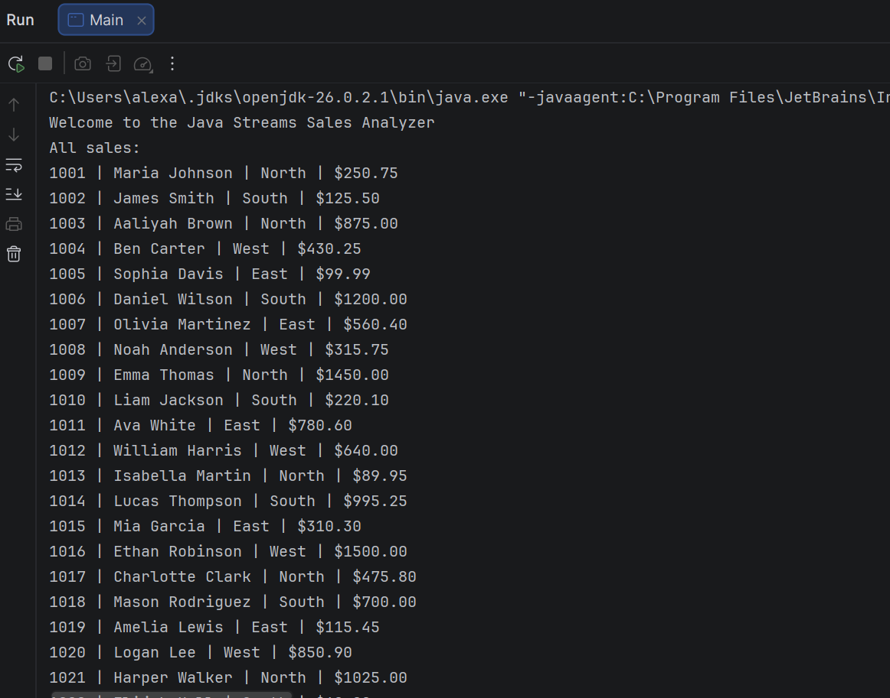
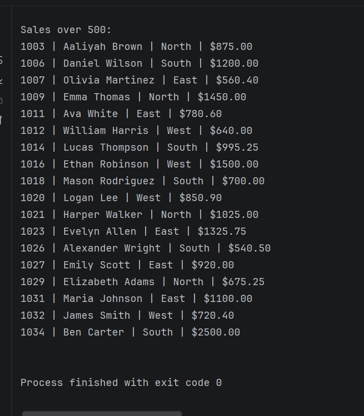
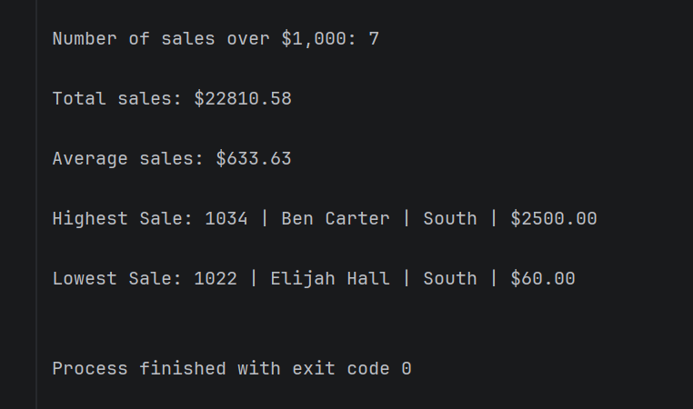
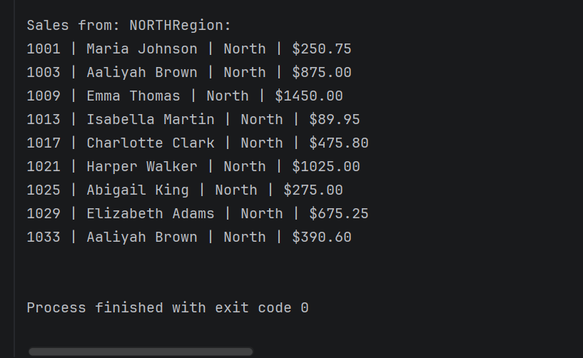
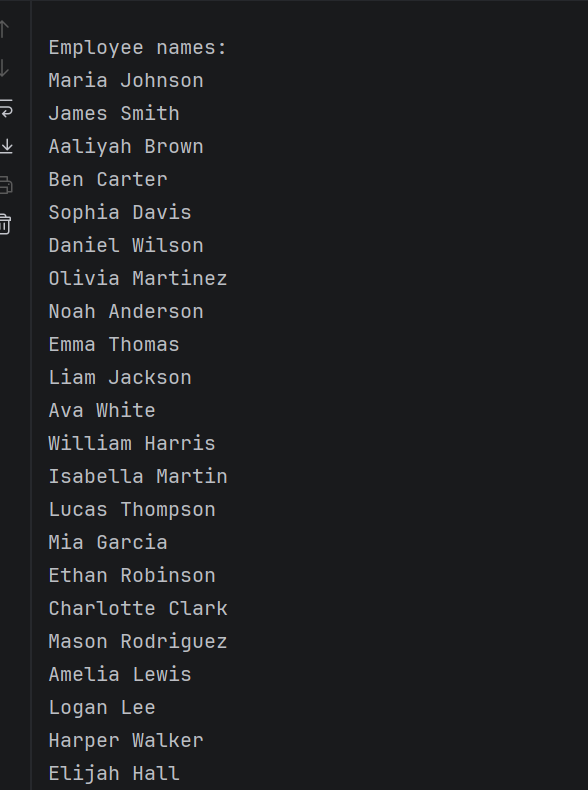

# Sales Data Stream Analyzer

## Project Description

A Java program that reads sales records from a CSV and uses Java streams to analyze the sales info. The program displays all sales, filters sales over $500, counts sales over $1,000, calculates total and average sales, finds the highest and lowest sales, displays sales from a selected region, and displays employee names.

## How to Run

1. Open the project in IntelliJ.
2. Run `Main.java`. (see Changing Region notes below to get output for different regions)
3. View the sales analysis output in the console.

### Changing the Region

The program displays sales from a selected region.

To display a different region, change `"NORTH"` to another available region such as `"SOUTH"`, `"EAST"`, or `"WEST"`, and re-run the program.

## CSV File

The program reads sales data from `sales.csv`.

Each sales record contains:

- Sale ID
- Employee name
- Region
- Amount

## Screenshots

### All Sales

### Sales Over $500

### Other Calculations

### Regional Sales (ex.NORTH)

### Employee Names
